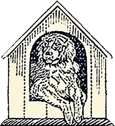

[](https://crates.io/crates/bowery)
[](https://www.npmjs.com/package/@imperialbower/bowery)
[](https://github.com/ImperialBower/bowery/actions/workflows/ci.yaml)
[](https://imperialbower.github.io/bowery/)
[](CODE_OF_CONDUCT.md)
[](LICENSE-MIT)
[](LICENSE-APACHE)
[](AI-BOM.md)

---

# Bowery


One poker table control, configured not compiled. `bowery` puts a poker table
in any web page as `<bowery-table>`: a strict replay of a recorded hand, an
interactive replay where the reader takes over any seat at any moment, or a
table against [pkcore](https://github.com/ImperialBower/pkcore)'s bots.
Seats, names, stacks, blinds, ante, button, deck, view and layout all come
from a YAML config in the page, and many tables can sit on one page. One Rust
crate builds two ways: an rlib kernel (config, check, game, frame, SVG
drawing) and, behind a `wasm` feature, the browser element. The design is
bower's [EPIC-20](https://github.com/ImperialBower/bower/blob/main/docs/EPIC-20_Bowery.md).

**Live demo: <https://imperialbower.github.io/bowery/>** — The Hand as a
replay and an interactive replay, and tables against the bots. It is
`demo/index.html`, published by `.github/workflows/pages.yaml` from `main`
once the browser proof passes.

## In a web page

```html
<script type="module" src="https://cdn.jsdelivr.net/npm/@imperialbower/bowery@0.1.2/bowery.js"></script>

<bowery-table>
  <script type="application/yaml">
mode: play
seat: 0
table: { stakes: { small_blind: 50.0, big_blind: 100.0 } }
players:
  - { seat: 0, name: You, stack: 10000 }
  - { seat: 1, stack: 10000, bot: tight_aggressive }
  - { seat: 2, stack: 10000, bot: maniac }
  </script>
  <p>A poker table: it needs JavaScript.</p>   <!-- the fallback, kept until the table is ready -->
</bowery-table>
```

The element loads its wasm from beside `bowery.js` (or from its `base`
attribute) and asks nothing of any other origin. To serve it yourself, take
`bowery-vX.Y.Z.tar.gz` from a [release](https://github.com/ImperialBower/bowery/releases):
one flat directory whose files `MANIFEST.sha256` lists. A config can also
come from a file (`src="table.yaml"`), and `mode: replay` or
`mode: interactive` take a recorded pkcore hand history as `hand:`. The
config's fields are documented on [`Config`](https://docs.rs/bowery/latest/bowery/config/struct.Config.html).

Every release is built and published by this repository's
[release workflow](.github/workflows/release.yml), with no stored tokens
(trusted publishing to crates.io and npm). To check what you installed:
`npm audit signatures` verifies the npm package's provenance, and
`sha256sum -c MANIFEST.sha256` verifies an unpacked release tarball.

## In Rust

```rust
use bowery::check::check;
use bowery::config::{Config, View};
use bowery::draw::{Theme, svg};
use bowery::game::Game;

let config = Config::from_yaml(yaml)?;
let game = Game::new(check(&config).map_err(|problems| problems[0].clone())?)?;
let picture = svg(&game.frame(View::All), config.layout, 680, Theme::Light);
```

`cargo run --example bowery-still -- fixtures/the_hand.yaml --layout spotlight --at river`
prints The Hand on the river as one SVG.

## Develop

```sh
git clone https://github.com/ImperialBower/bowery.git
cd bowery
make install-tools   # the wasm target, cargo-deny, cargo-audit, cargo-watch
make ayce            # the full gate, the wasm size gate and the Playwright proof included
make serve           # the demo at http://localhost:8000
```

`make ayce` also needs `wasm-pack` and Node (see `.tool-versions`). `make help`
lists every target.

## What's in the box

- **Toolchain:** Rust, edition 2024, MSRV pinned to pkcore's — see [toolchain decisions](.okf/decisions/toolchain.md)
- **Formatting:** rustfmt — see [toolchain decisions](.okf/decisions/toolchain.md)
- **Linting:** clippy at pedantic, warnings as errors — see [toolchain decisions](.okf/decisions/toolchain.md)
- **Supply-chain policy:** cargo-deny — see [toolchain decisions](.okf/decisions/toolchain.md)
- **Security scanning:** cargo-audit plus cargo-deny advisories, daily in CI — see [toolchain decisions](.okf/decisions/toolchain.md)
- **Docs:** rustdoc with warnings as errors — see [toolchain decisions](.okf/decisions/toolchain.md)
- **Quality gate:** `make ayce` — see [quality gate](.okf/processes/quality-gate.md)

## License

Licensed under either of [Apache License, Version 2.0](LICENSE-APACHE) or
[MIT license](LICENSE-MIT) at your option.
